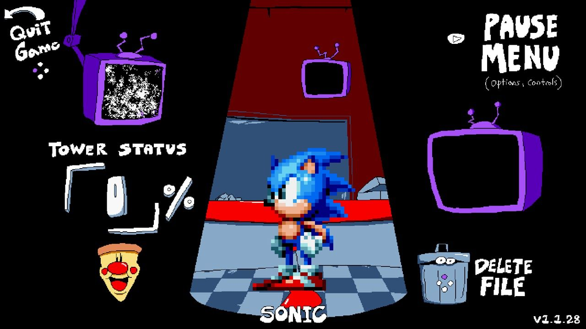
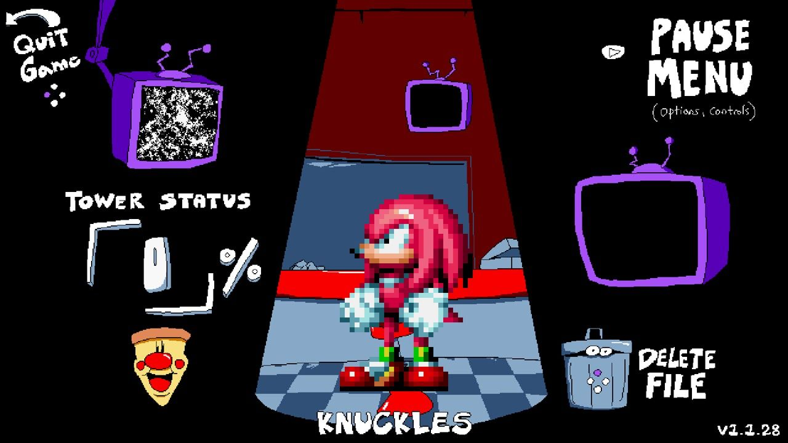
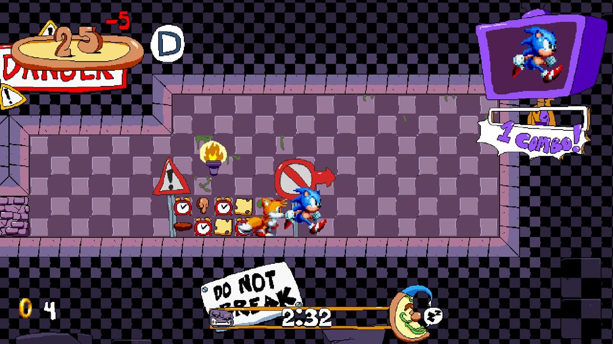
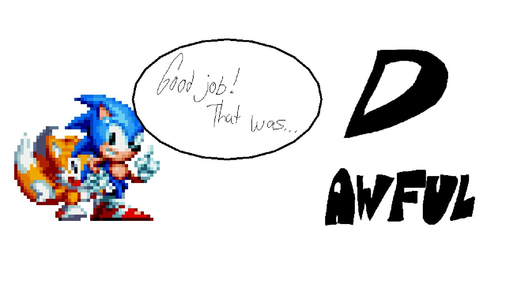
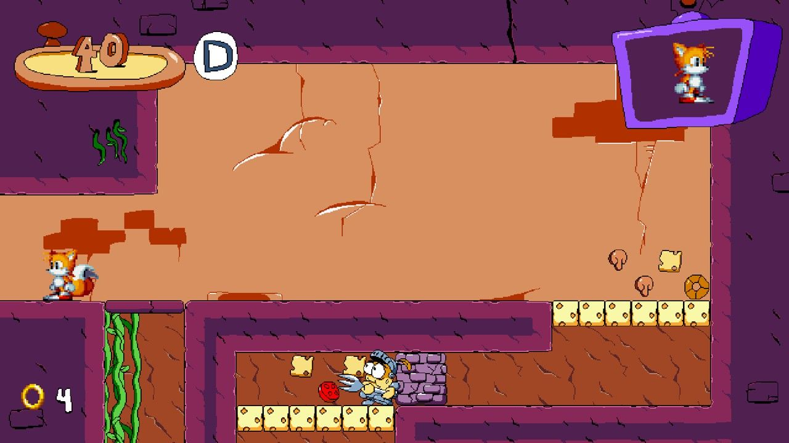

# Sonic-Tower

A Pizza Tower mod that adds Sonic and friends from Sonic Mania into the game! Made using Claude Opus 5.5.

Play through Pizza Tower's levels with Sonic Mania's momentum, spindash into everything, keep Peppino's combo and rank going, and hear Mania's sound effects over Pizza Tower's music. Pick Sonic & Tails, Sonic, Tails or Knuckles on the file select, just like in Mania.

**You need your own copies of both games.** This repository has no game files in it. Sonic Tower reads the sprites and sounds from your Sonic Mania and builds a separate copy of Pizza Tower's data the first time it runs. Your games' own files are never changed.



| | |
|---|---|
|  |  |
|  |  |

## What it does

- **Mania movement:** acceleration, friction, skidding, slopes, rolling, spindash and drop dash.
- **Four choices on the file select:** press up or down to pick Sonic & Tails, Sonic, Tails or Knuckles.
- **Each character's own air move:** Sonic's drop dash, Tails's flight, Knuckles's glide and wall climb.
- **Pizza Tower's game around it:** combos, ranks, Pizza Time, secrets, bosses and music all stay.
- **Rings:** you collect them through the level and they scatter when you're hit.
- **The character replaces Peppino** on the file select, the TV, the results screen (every rank, with a victory pose and a camera move), the boss VS art and in the game's words.
- **Pizza Tower's own moves are here too:** Mach Run as a boost, Grab Dash, throwing, uppercut, long jump, wall runs and wall jumps, super jump.
- **The tutorial signs and hub tips teach these moves** (English only).
- **Separate saves,** so your Pizza Tower saves are left alone.

### Controls

These use your Pizza Tower buttons.

| Button | Move |
|---|---|
| Left / right | Run, with Mania's momentum |
| Jump | Jump as a ball that breaks blocks and defeats enemies. Still counts just before landing or just after leaving a ledge |
| Mach Run button, held | Boost: quick to full speed, and at speed Sonic breaks blocks and defeats enemies by running into them |
| Grab button | Grab Dash: breaks marble and grabs enemies. Jump during it for a long jump, down during it to slide |
| Grab button while carrying | Throw. Hold up to throw upward |
| Up + grab button | Uppercut |
| Down + jump | Spindash: tap jump to rev, let go of down to release |
| Down while moving | Roll |
| Down + a direction from a standstill | Crawl into low gaps |
| Jump again in the air | Sonic: hold for a drop dash. Tails: tap to fly. Knuckles: hold to glide, hit a wall to climb |
| Up + jump, at any speed | Super jump: let go of up to launch |
| Down + jump in the air | Slam down through floors |
| Run into a wall at speed, or boost into it | Run up it. Jump to leap off, let go to drop |
| Taunt | A different pose each time, with Pizza Tower's taunt and parry timing |
| Up at a door or gate | Walk in |

### Known limits

- Cutscenes drawn as pictures still show Peppino.
- Transformations use general poses rather than new art.
- The Grab Dash, carrying and throwing also use general poses, since Mania has no art for them.
- The frame rate isn't a locked 60. Tests hold 56 to 61 in most rooms, with some dips and short hitches right after a room loads.
- It's only been played through by a test bot and one person, so expect some bugs. Damage to the Pepperman, Vigilante and Pizzaface bosses hasn't been confirmed by the bot.
- Song titles in the sound test keep their real names, such as "Peppino's Sauce Machine".

## Setting it up

Sonic Tower runs on Windows. There's no ready-made download in this repository yet, so build it first (below). Then start it with the paths to your two games:

```powershell
dist\SonicTower.exe --game "C:\Program Files (x86)\Steam\steamapps\common\Pizza Tower" --mania "C:\Program Files (x86)\Steam\steamapps\common\Sonic Mania"
```

The first start takes about a minute while it builds its copy of Pizza Tower's data in `%LOCALAPPDATA%\SonicTower`. After that it starts straight away. Keep both paths in a desktop shortcut so you only have to set them up once.

If you have ReShade in your Pizza Tower folder, Sonic Tower keeps it from loading because it can crash the game. Your ReShade files aren't changed.

## Building from source

You need:

1. [.NET SDK](https://dotnet.microsoft.com/download) 8 or later. The launcher targets .NET Framework 4.8, and its reference files come from NuGet.
2. [Python 3](https://www.python.org/downloads/).
3. The command-line build of [UndertaleModTool 0.9.2.0](https://github.com/UnderminersTeam/UndertaleModTool/releases), unzipped so that `.tools\utmt-cli\UndertaleModCli.exe` exists in this folder.

Then run this from the repository's folder:

```powershell
powershell -ExecutionPolicy Bypass -File tools\build.ps1
```

If `dotnet` isn't on your PATH, set `$env:DOTNET` to its full path first. The script checks the sheets, generates the tables, builds the launcher and lays out the finished program in `dist\`. A build doesn't touch either game.

## How it works

```
launcher/   SonicTower.exe: reads Mania's Data.rsdk, unpacks the sprites and sounds, runs the patch, starts the game
patch/      The UndertaleModTool script that adds the mod's code to a separate copy of Pizza Tower's data
gml/        The mod itself, written in GameMaker Language (st_tables.gml is generated)
sheets/     The source of truth: physics, moves, sounds, states, characters, text, hooks and test checks
tools/      build.ps1, and preflight_and_generate.py, which checks the sheets and generates the tables
```

To change a value, change its sheet rather than the code. `sheets/physics.json` holds every movement number, `sheets/characters.json` the four choices and `sheets/text.json` the rewritten English lines. `preflight_and_generate.py` refuses to build if a cell is empty or a reference doesn't resolve.

Most of the mod works by swapping calls: `sheets/hooks.json` lists each game function and the mod's wrapper for it, and the patch redirects the game's calls to the wrapper.

`tools/seed_sheets.py` is a one-off that created the first version of the sheets from a decompile of the game. You don't need it, and running it would overwrite the sheets.

## Credits

- Pizza Tower is by Tour De Pizza.
- Sonic Mania is by SEGA, Christian Whitehead, Headcannon and PagodaWest Games.
- [UndertaleModTool](https://github.com/UnderminersTeam/UndertaleModTool) is by the UndertaleModTool contributors (GPL-3.0). It's a separate program that the launcher starts unchanged. See `THIRD-PARTY.txt`.

Sonic Tower is an unofficial fan mod, not affiliated with any of them. This repository's own code and text are all rights reserved (see `LICENSE`). That doesn't extend to either game or their characters and art, which are their owners'.
